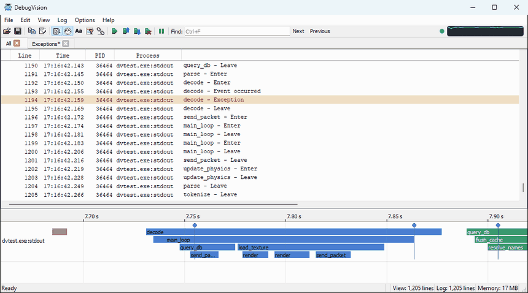

The first release of DebugVision: a log viewer that turns the logs your software already writes into a picture of what it
does, with the features of DebugView++, a timeline, and a command line version.



## Downloads

| File | |
|---|---|
| `DebugVision-<version>-windows-x64.zip` | Windows 10/11 x64: `debugvision.exe` is self-contained (no installation, no Visual C++ redistributable needed), with `dvcli.exe` and `dvtest.exe` |
| `debugvision_<version>-1~deb12_amd64.deb` | Debian 12 (bookworm) |
| `debugvision_<version>-1~deb13_amd64.deb` | Debian 13 (trixie) |
| `SHA256SUMS` | checksums of the files |

On Debian, install the package with its dependencies:

```
sudo apt install ./debugvision_<version>-1~deb13_amd64.deb
```

It installs into `/opt/debugvision`, with `debugvision`, `dvcli` and `dvtest` in `/usr/bin` and an entry in the
applications menu.

## Features

- **Sources**: Win32 OutputDebugString (local and global), log files (tailed through truncation and rotation, DebugView++
  `.dblog` and Sysinternals `.log` formats), program output, standard input, UDP (with multicast and a sender filter),
  TCP, the Sysinternals DebugView agent, and log files on a web server over http(s)
- **Drag and drop**: drop a log file to open it, an executable or script to run it, or an `http(s)://` link to tail it
- **http(s) sources**: Range requests fetch only the new bytes; works through http, https and SOCKS proxies (e.g. an
  `ssh -D` tunnel), with proxy authentication (basic, digest, NTLM, Negotiate), the proxy settings of Windows, and
  suggestions for the SOCKS proxies found on this computer
- **Views and filters**: views as tabs, each with its own filters: include, exclude, highlight, token, stop, track, once,
  clear, beep and bookmark, as regular expressions (PCRE2) or plain text; find, bookmarks, process colors, clock or relative time
- **Timeline**: the lines of a view on a time axis, as spans from a begin line to an end line and as events, with rules
  in the filter dialog; `dvtest` generates test data for it
- **Columns**: show, hide and reorder them; double-click the separator in the header to fit a column to the visible lines
- **Traffic indicator**: an optional light and graph of the incoming lines in the toolbar
- **Saving**: the log, the view or the selection in DebugView++ `.dblog` format; views, filters and sources as a configuration file
- **dvcli**: capture and filter on the command line, write to the console and/or a `.dblog` file, quit on a message,
  exit when all sources have ended, send UDP test messages
- **User manual**: compiled into both programs (`debugvision --help`, Help > User Manual, `dvcli --webhelp`)

macOS and other Linux distributions: build from source, see the [README](https://github.com/CobaltFusion/DebugVision#building).
